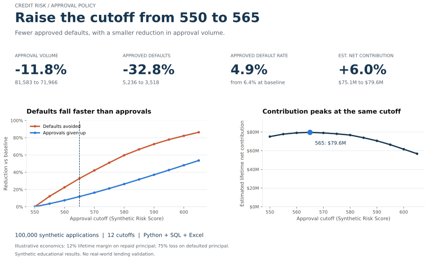
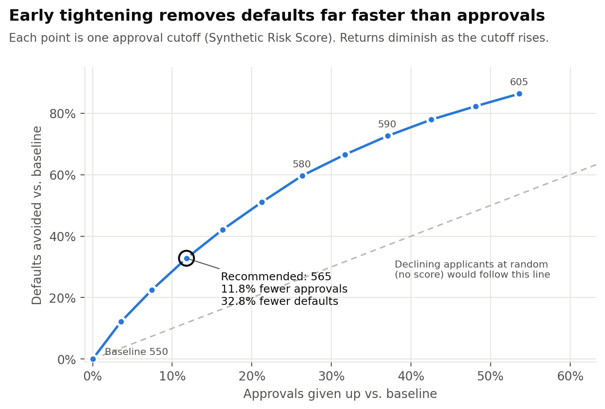
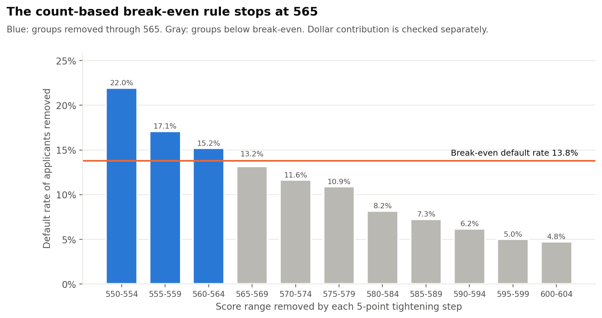
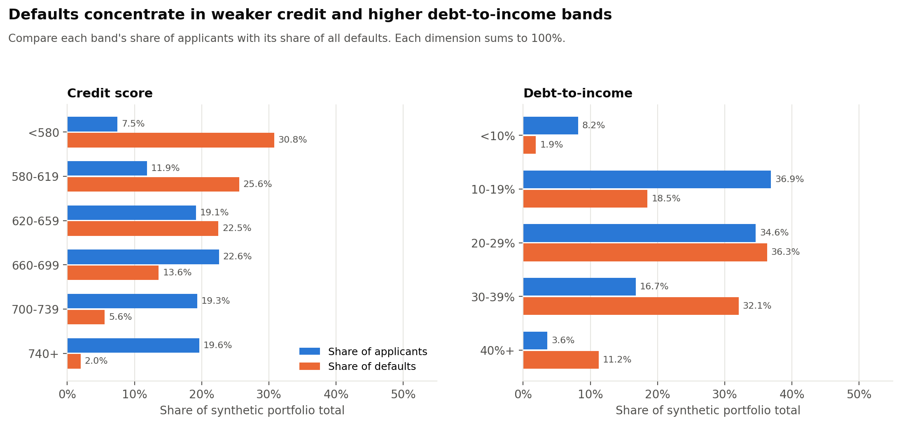
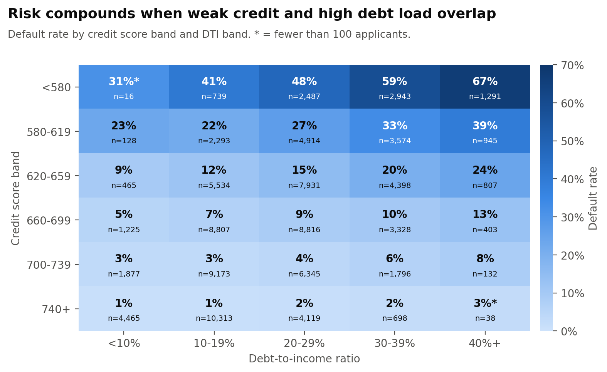
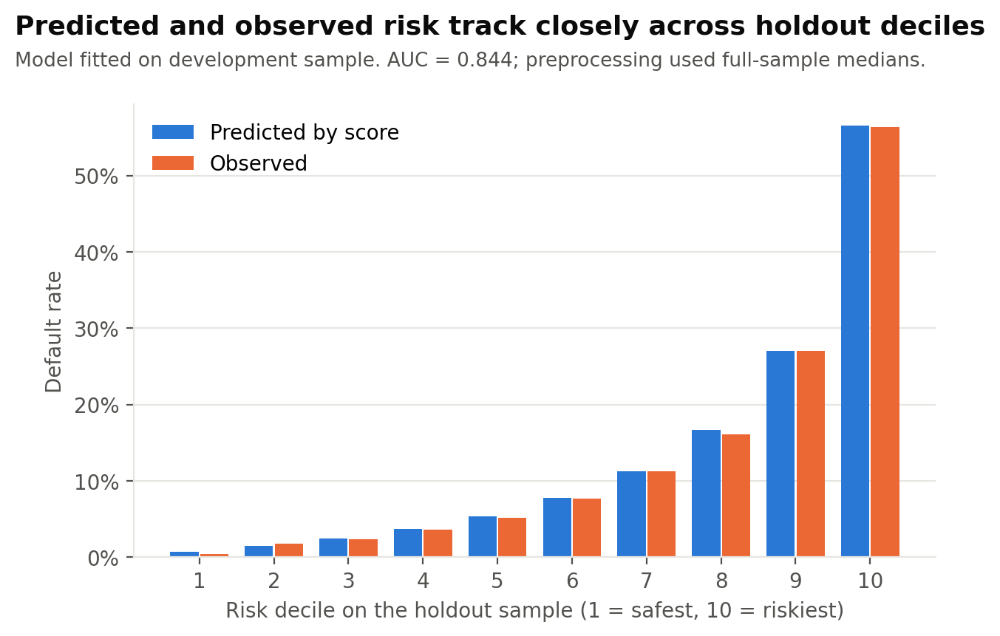

# Credit Risk & Approval Optimization Analysis

[](https://github.com/masarcode/Credit-Risk-Approval-Optimization-Analysis/actions/workflows/tests.yml)

**How far should a lender raise its approval cutoff to reduce default exposure without giving up too much profitable approval volume?**

This project evaluates 12 approval policies across **100,000 synthetic consumer credit applications** using Python, SQL and Excel. Under the illustrative base-case economics, raising the Synthetic Risk Score cutoff from **550 to 565** reduces approved defaults by **32.8%**, gives up **11.8%** of approval volume, and increases estimated lifetime net contribution by **6.0%**.



These are simulated results, not evidence about real borrowers or a recommendation for an actual lender. The value of the project is the decision framework and the reconciliation of the supporting analysis.

## Portfolio snapshot

| Evidence | Result |
|---|---:|
| Synthetic applications | 100,000 |
| Approval scenarios | 12, from 550 through 605 |
| Recommended cutoff | 565, from an assumed baseline of 550 |
| Approved applicants | 81,583 to 71,966 (-11.8%) |
| Approval rate | 81.6% to 72.0% |
| Defaults among approved loans | 5,236 to 3,518 (-32.8%) |
| Approved-book default rate | 6.4% to 4.9% |
| Estimated lifetime net contribution | $75.1M to $79.6M (+6.0%) |
| Model holdout AUC | 0.844 |
| Pipeline validation | 38 of 38 checks passed |
| Automated tests | 57 passed locally |

## Executive recommendation

For this synthetic cohort, move the cutoff to **565**. That gives up **9,617 approvals** while avoiding **1,718 defaults**. Estimated credit losses fall from **$53.0M to $35.9M**. The reduction in losses exceeds the contribution forgone on loans that would have repaid, producing a **$4.5M** increase in estimated net contribution.

The decision is sensitive to the assumed economics. At an 8% margin, the same rule selects 580; at a 16% margin, it selects 555. The base-case result should be read as an illustrative policy comparison, not a precise or universal optimum.

- [One-page executive summary](outputs/executive_summary/executive_summary.pdf)
- [Excel decision model](outputs/excel/credit_risk_decision_workbook.xlsx)
- [All scenario results](outputs/tables/scenario_results.csv)
- [Full methodology](docs/methodology.md)

## Approval threshold trade-off



Each point represents one cutoff. At 565, defaults decline about **2.8 times as fast as approval volume**, measured as percentage changes from the baseline. More restrictive policies keep reducing defaults, but increasingly reject applicants who would have repaid.

## Why 565?

The base case assumes a **12% lifetime margin on principal that repays**, **75% loss given default**, and an initial cutoff of **550**. These are illustrative assumptions, not estimates of bank economics.

For equal-sized loans, the break-even default rate is:

`margin / (margin + loss given default) = 12% / 87% = 13.8%`

The rule raises the cutoff in 5-point steps while the group removed at each step defaults above that rate. It stops when the next group falls below break-even.



The last removed group, scores 560-564, defaults at **15.2%**. The next group, 565-569, defaults at **13.2%**, below break-even. The implemented rule uses borrower counts. Since loan amounts differ, the project separately calculates dollar contribution using each loan's principal and outcome. That dollar comparison also peaks at 565 in this cohort; the two approaches need not agree in other portfolios.

| Assumed lifetime margin | Break-even default rate | Rule-selected cutoff |
|---|---:|---:|
| 8% | 9.6% | 580 |
| 12% | 13.8% | 565 |
| 16% | 17.6% | 555 |

Loss given default stays at 75% in this comparison. See the [sensitivity table](outputs/tables/risk_appetite_sensitivity.csv).

## Where risk is concentrated

In the synthetic portfolio:

- Applicants with credit scores below 620 account for **19% of applications but 56% of defaults**.
- Five credit-score and DTI combinations contain **22% of applicants and 50% of defaults**. All combine a score below 660 with DTI of at least 20%.
- The 580-659 credit-score bands account for **79% of approvals lost** when tightening to 565.





The heatmap includes cell counts so small groups are visible. Credit score here is a synthetic bureau-style input, distinct from the model's Synthetic Risk Score used to set approval cutoffs. SQL analysis also covers income, utilization, delinquency history, and loan size.

## Model and evaluation

An interpretable logistic regression estimates default probability. Feature screening and coefficient fitting use a **69,894-record development sample**; model performance is measured on **30,106 holdout records**. Nine of eleven candidate features are retained.

Predicted probabilities become a **Synthetic Risk Score**, which is not FICO: 600 points represents 20-to-1 repayment odds, and every additional 20 points doubles those odds. Higher scores imply lower predicted risk.



Holdout AUC is **0.844**. Average predicted default probability is **13.29%**, versus **13.19%** observed. Similar development and holdout AUCs indicate little measured performance gap, not proof that overfitting is absent.

Two evaluation limits matter: median imputation occurs before the split, and the approval cutoff is selected using outcomes from the full portfolio. The holdout AUC evaluates model ranking with that preprocessing caveat; the holdout subgroup's policy results are descriptive, not an independent test of the chosen cutoff.

## Excel decision model

The [workbook](outputs/excel/credit_risk_decision_workbook.xlsx) keeps the decision inputs visible. Change the yellow baseline, margin or loss-rate cells to recalculate break-even, scenario losses, contribution and the recommended cutoff within the existing 550-605 grid.

Applicant counts and loan volumes come from the Python/SQL outputs. Changing the workbook does not retrain the score or regenerate applicants. Segment findings and the separate risk-appetite table are labeled base-case pipeline snapshots. Recalculate on opening in Excel. See [verification notes](docs/verification.md) for the tested inputs and calculation-engine limits.

## Validation and reproducibility

The pipeline checks unique applicant IDs, types, ranges, missing data, score behavior, scenario consistency, and agreement between independent Python and SQL calculations. It stops on a failed check and writes a [38-check report](outputs/tables/validation_report.csv).

The **57 automated tests** include malformed-input cases, SQL band parity, Excel formula structure, output checks, and a fresh-run comparison with committed headline results. Random seed `20260922` fixes generation and the model split. Analytical tables reproduce under the pinned environment; floating-point results can vary slightly with different numerical libraries. Binary report files are not used as the reproducibility standard.

### How the analysis works

1. Generate synthetic applications with correlated financial and credit fields.
2. Remove duplicates, repair DTI units, impute missing values, and log each change.
3. Fit the logistic scorecard and evaluate its ranking and calibration.
4. Load scored applicants into SQLite with schema constraints.
5. Evaluate 12 approval cutoffs independently in Python and SQL.
6. Identify risk concentrations and the segments affected by tightening.
7. Apply the marginal rule and cross-check dollar contribution.
8. Generate the figures, decision workbook and executive summary.
9. Reconcile outputs and run the automated tests.

### Reproduce the analysis

Tested with **Python 3.12**. From the repository root:

```bash
python -m venv .venv
source .venv/bin/activate
python -m pip install -r requirements.txt
python scripts/run_pipeline.py
python -m pytest
```

On Windows, activate with `.venv\Scripts\activate`. No external data download or credentials are required. To rebuild reports from the committed tables without rerunning the model:

```bash
python scripts/build_outputs.py
```

The CI workflow runs the pipeline and test suite on pushes and pull requests.

## Repository map

| Location | Contents |
|---|---|
| `config/` | Seed, scenario grid, economic assumptions and segment definitions |
| `src/credit_risk/` | Generation, cleaning, scoring, scenarios, validation and reporting |
| `sql/` | SQLite schema, segmentation queries and independent scenario calculations |
| `scripts/` | Full pipeline and report-only entry points |
| `tests/` | Analytical, data-quality, reconciliation and output tests |
| `notebooks/` | Optional exploratory walkthrough |
| `outputs/figures/` | Six analytical visuals, including an SVG portfolio overview |
| `outputs/tables/` | Compact reporting tables and validation evidence |
| `outputs/excel/` | Editable decision workbook |
| `outputs/executive_summary/` | One-page PDF briefing and Markdown version |
| `docs/` | Methodology, data dictionary and verification notes |

Large raw files, scored records and the SQLite database are generated locally and excluded from version control. Field definitions and table grains are in the [data dictionary](docs/data_dictionary.md).

## Limitations and fair-lending note

All data is synthetic, and the model has no real-world validation. The simulation exposes outcomes for declined applicants; real underwriting faces a reject-inference problem. A single cohort, uniform pricing, fixed loss severity and one cutoff omit important aspects of lending. The recommendation is retrospective and sensitive to the assumed economics.

Protected characteristics and geographic identifiers are excluded. Their absence does not establish fairness or rule out proxies. Real use would require independent validation, fairness testing, governance, compliance review, monitoring and adverse-action processes. This score should not be used for lending decisions.

**Tools demonstrated:** Python, pandas, NumPy, statsmodels, SciPy, SQL, SQLite, Excel, matplotlib, openpyxl, ReportLab and pytest.

Code is released under the [MIT License](LICENSE).
