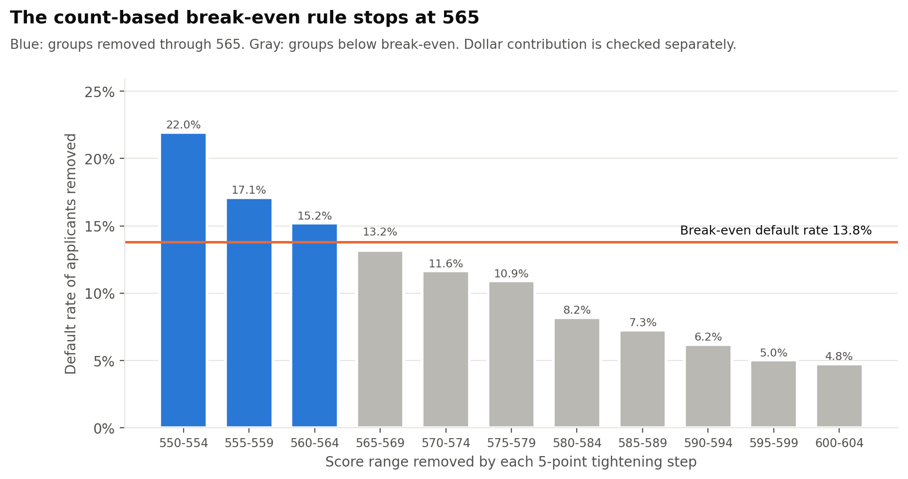

# Credit Risk & Approval Optimization: Executive Summary

*Synthetic educational analysis of 100,000 consumer loan applications. Not for real lending decisions.*

**Business question.** How should a consumer lender adjust its approval cutoff to reduce default exposure while keeping as much approval volume as possible? We treat this as a trade-off, not a race to zero defaults.

| | Baseline | Recommended | Change |
|---|---:|---:|---:|
| Approval cutoff (Synthetic Risk Score) | 550 | 565 | +15 points |
| Applicants approved | 81,583 | 71,966 | -11.8% |
| Approval rate | 81.6% | 72.0% | -9.6 pts |
| Defaults among approved loans | 5,236 | 3,518 | -32.8% |
| Default rate of approved loans | 6.4% | 4.9% | -1.5 pts |

## Recommendation

Raise the approval cutoff on the Synthetic Risk Score from **550** to **565** (+15 points). Approvals fall 11.8% (81,583 to 71,966) while defaults among approved loans fall 32.8% (5,236 to 3,518). Each 5-point slice removed on the way to 565 defaults at 15.2% or more, above the 13.8% count-based break-even rate. The next slice defaults at 13.2%, below break-even, so the rule stops. A separate calculation using loan principal shows estimated portfolio contribution rises 6.0% and peaks at 565.

A more conservative lender (assumed margin 8%, break-even 9.6%) would stop at 580, giving up 26% of approvals to cut defaults 60%. A growth-focused lender (margin 16%) would stop at 555. The recommendation depends on the lender's economics and risk appetite; there is no single correct cutoff.

## Where the risk sits

- Applicants with credit scores below 620 are 19% of applicants but 56% of all defaults.
- Five credit-score x DTI combinations hold 22% of applicants and 50% of defaults; all combine a sub-660 score with DTI of 20% or more.
- Default rates climb from 3.1% for DTI under 10% to 41.2% for DTI of 40% or more.
- Moving to the recommended cutoff mainly affects the 580-659 score bands (79% of approvals given up); applicants scoring 700+ are almost untouched (1.8%).
- Loan size alone barely separates risk (default rates of 12.2% to 15.8% across size bands); what matters is loan size relative to income.

## How the analysis works

- 100,000 synthetic applications generated with a fixed seed; built-in risk relationships plus random noise. Cleaning removed duplicates, fixed unit errors and imputed missing values.
- Transparent logistic-regression scorecard (9 factors, no protected characteristics). Holdout AUC 0.84; predicted and observed default rates within 0.1 points.
- 12 cutoffs from 550 upward in 5-point steps, computed in Python and independently in SQL (SQLite); results reconcile exactly. 38 of 38 validation checks pass.
- Unit economics are illustrative: 12% lifetime margin on loans that repay, 75% of principal lost on defaults.

## Limitations

- Synthetic data. Relationships are designed, not estimated from real loan performance.
- Outcomes are known for declined applicants too; a real lender sees only approved loans.
- Results are sensitive to the assumed margin and loss rate; slices next to the break-even line differ by only 1 to 2 points of default rate.
- Full-sample imputation and cutoff selection limit holdout independence. Count-based rule; dollar contribution checked separately.
